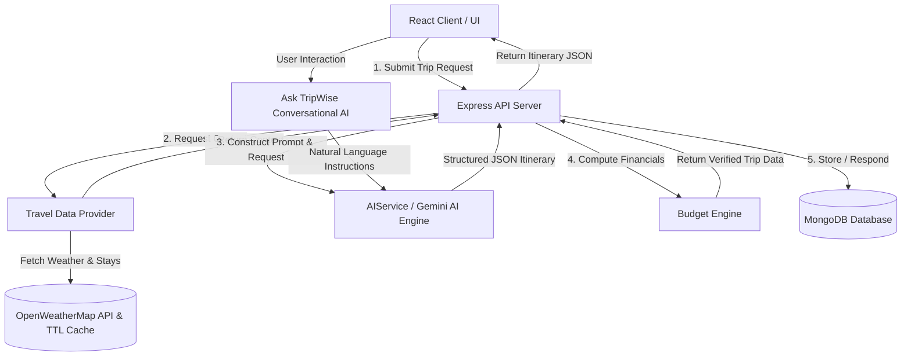

# TripWise AI ✈️🌴
### *Next-Generation AI-Powered Travel Planning & Intelligent Itinerary Engine*

---

## 📌 Executive Overview

**TripWise AI** is a full-stack, AI-driven travel planning platform that transforms end-to-end trip curation into a seamless, hyper-personalized experience. Powered by advanced AI models (Google Gemini) and real-time travel context providers, TripWise AI crafts complete, day-by-day itineraries tailored to traveler demographics, budget constraints, travel styles, dietary requirements, and specific interest profiles.

Beyond static itinerary generation, TripWise AI acts as a smart, interactive travel companion. It provides real-time budget verification, automated cost optimization, natural language conversational itinerary editing, weather integration, location mapping, and multi-format exporting (PDF documents).

---

## 🌟 Key Features & Core Capabilities

### 1. 🎯 Multi-Step Smart Trip Wizard
- **Logistics & Demographics**: Select starting location, destination, date ranges (with auto-calculated duration in days/nights), and detailed traveler counts (adults, children with age tracking, and infants).
- **Budget & Travel Style**: Set exact budget caps across multiple currencies (`INR ₹`, `USD $`, `EUR €`, `GBP £`), paired with travel styles ranging from *Backpacker/Budget* to *5-Star Luxury*, and trip pacing (*Relaxed*, *Balanced*, *Packed*).
- **Lifestyle & Interest Matching**: Filter by specific interests (Beaches, Trekking, History, Food, Nightlife, Wellness, Museums, etc.), dietary preferences (Vegetarian, Vegan, Jain, Non-Veg), accommodation types, and transit modes.
- **Deep Personalization & Accessibility**: Include must-visit landmarks, special trip occasions (Honeymoon, Anniversary, Birthday, Solo), accessibility tags (Wheelchair accessible, elderly-friendly, minimal walking), and custom freeform notes.

### 2. 🤖 Gemini AI Itinerary Generation Engine
- **Structured JSON Parsing**: Constructs rich prompts via a dedicated `PromptBuilder` and parses validated JSON outputs into structured daily timelines.
- **Detailed Timelines**: Each day includes timed activities, duration estimates, location names, category tags, cost estimates with price types (`live` vs `estimated`), daily weather outlook, and curated breakfast/lunch/dinner recommendations.
- **Resilient Fallback Architecture**: Built with fail-safe fallback generators (`AIResponseValidator` and `MockTravelDataProvider`) to guarantee seamless operation even during API key constraints or rate limiting.

### 3. 📊 Automated Budget Verification & Optimization Engine
- **Expense Categorization**: Breaks down costs into five distinct buckets: *Transportation*, *Accommodation*, *Food*, *Activities*, and *Miscellaneous Buffer*.
- **Live Status Assessment**: Calculates total estimated expenses against the user's target budget and tags the trip as `WITHIN_BUDGET` or `OVER_BUDGET`.
- **✨ One-Click AI Budget Optimization**: Dynamically recalibrates cost allocations, suggests local transit passes, optimizes meal selections, and applies cost reductions without sacrificing trip quality.

### 4. 💬 Conversational AI Editor ("Ask TripWise")
- **Natural Language Refinement**: Edit trips on the fly by giving plain text commands (e.g., *"Make Day 2 more relaxed"*, *"Swap museum visits for beach sunset spots"*, *"Add more local street food dinners"*).
- **Version Control & State History**: Maintains full history snapshots (`trip.history`), enabling single-click reversion to previous versions before any AI edit.

### 5. 📄 Export & Visualization Tools
- **Interactive Map View**: Integrates visual destination mapping for spatial context during trip exploration.
- **PDF Generation**: Native client-side PDF export engine powered by `html2pdf.js`, generating printable travel documents complete with timelines, stay recommendations, and financial summaries.

### 6. 🔐 User Account & Dashboard Management
- **User Authentication**: Secure JWT-based authentication with bcrypt password encryption.
- **Saved Trips Dashboard**: Save generated itineraries, review past trips, manage profile preferences, and track budget analytics.

---

## 🏗️ System Architecture & Working Mechanism



### End-to-End Workflow:
1. **User Input Collection**: The client collects travel parameters across a 4-step wizard interface.
2. **Context Enrichment**: The backend queries `TravelDataProvider` to collect destination weather forecasts, stay options, transport options, and local attractions. Weather responses are cached in MongoDB using a TTL index to minimize external API consumption.
3. **AI Generation**: `PromptBuilder` combines user parameters and live context into an optimized prompt sent to `GeminiProvider`. The response is validated by `AIResponseValidator`.
4. **Financial Verification**: The itinerary days are passed to `BudgetService`, which calculates exact expense distributions, applies buffer percentages, and determines budget compliance.
5. **Client Rendering**: The assembled trip data is returned to the frontend, updating state via `TripContext` and rendering interactive timelines, budget cards, maps, and accommodation suggestions.
6. **Iterative Refinement**: Users can interact with the trip by running budget optimization or triggering conversational edits via "Ask TripWise", creating version history snapshots along the way.

---

## 💻 Technology Stack

| Layer | Technologies & Tools |
| :--- | :--- |
| **Frontend Framework** | React 18, React Router DOM v6, Vite |
| **State & UI System** | React Context API (`AuthContext`, `TripContext`), Bootstrap 5, Bootstrap Icons, Custom Design System |
| **Client PDF Export** | `html2pdf.js` |
| **Backend Server** | Node.js, Express.js (RESTful API architecture) |
| **Database & Cache** | MongoDB, Mongoose ODM, MongoDB TTL Indexing (`TravelCache`) |
| **AI Integration** | Google Gemini API (`@google/generative-ai`), Custom Prompt Builder & Response Validator |
| **External APIs** | OpenWeatherMap API |
| **Security & Auth** | JSON Web Tokens (JWT), Bcrypt password hashing, Express CORS middleware |

---

## 📂 Project Structure & Module Breakdown

```text
TripWise_AI/
├── backend/
│   ├── src/
│   │   ├── config/             # Environment & DB configurations
│   │   ├── controllers/        # Request handlers (auth, trip, travel, AI)
│   │   ├── middleware/         # Auth verification & error handling
│   │   ├── models/             # Mongoose Schemas (Trip, User, AIUsage, TravelCache)
│   │   ├── routes/             # Express API endpoints
│   │   └── services/
│   │       ├── ai/             # AIService, GeminiProvider, PromptBuilder, Validator
│   │       ├── budget/         # BudgetService (Calculations & Optimization logic)
│   │       ├── cache/          # CacheService (MongoDB TTL cache layer)
│   │       └── travel/         # TravelDataProvider (Real & Mock provider fallback)
│   ├── app.js                  # Express app setup & middleware
│   └── server.js               # Entry point
│
└── frontend/
    ├── src/
    │   ├── components/         # Reusable UI components (DayTimeline, BudgetCard, MapView, PDFDocument, etc.)
    │   ├── context/            # Global state (AuthContext, TripContext)
    │   ├── pages/              # Primary views (Home, CreateTrip, TripDetails, Dashboard, Profile, Login, Register)
    │   ├── services/           # Axios API services (tripService, authService, api)
    │   └── styles/             # Global design tokens and Bootstrap customizations
    ├── index.html              # HTML root template
    └── vite.config.js          # Vite build tool setup
```

---

## 📝 Data Schema Architecture

### Key Models Overview:
- **`Trip`**: Stores complete trip metadata (destination, origin, dates, travelers, budget, currency, style, pace, preferences), day-by-day `itinerary` array (activities, weather, meals, transportation), `budgetBreakdown` object, `hotels`, `transportOptions`, recommendations, warnings, and `history` array for version control.
- **`User`**: Manages user credentials (hashed password), name, email, subscription tier (`FREE` vs `PREMIUM`), and preferred currency.
- **`TravelCache`**: Implements MongoDB TTL caching for external API responses (weather, places, hotels) to reduce latency and API calls.
- **`AIUsage`**: Logs AI request telemetry including model used, execution duration (ms), request type, user ID, and success/failure status.

---

## 📄 Summary

**TripWise AI** bridges the gap between raw AI generation and practical travel execution. By combining artificial intelligence with strict budget validation rules, real-time context integration, and intuitive conversational UI controls, it provides a comprehensive end-to-end solution for modern travel planning.
